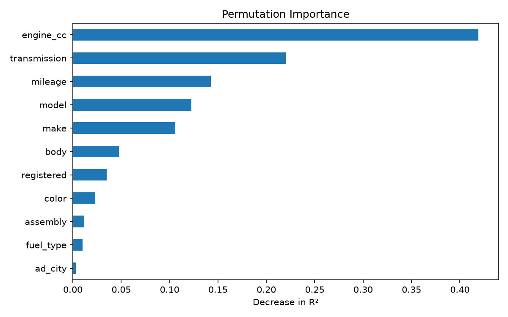

# Pakistan Used Car Price Predictor

Predicts the asking price of a used car in Pakistan from its listing details, trained on 70,000+ cleaned listings with Python and scikit-learn.

**Live app:** https://pakistan-car-price-predictor-10.streamlit.app/

On unseen listings the final model (Gradient Boosting) has a **median error of 12.9%** and explains **88% of the variation in log price** (R² = 0.877). The free app may take a few seconds to wake up if it has been idle.

## Results

Models were compared with 3-fold cross-validation on the training set (80% of the data). The test set (20%, 14,194 listings) was used once, for the final model only. Models predict `log(price)`, and predictions are converted back to PKR.

| Model | CV R² | CV MAE (log price) |
|---|---|---|
| Linear Regression | 0.803 | 0.261 |
| Random Forest | 0.861 | 0.193 |
| **Gradient Boosting** | **0.870** | 0.198 |

I chose Gradient Boosting for its higher R², faster training and a much smaller saved model than a 150-tree Random Forest. Random Forest was marginally better on MAE, so the two are close.

**Final test-set performance (Gradient Boosting):**

| Metric | Value |
|---|---|
| R² (log price) | 0.877 |
| MAE | PKR 552,739 |
| Median absolute % error | 12.9% |

### Where the model is weaker

Errors are largest for cheap cars, where a small rupee difference is a big percentage:

| Price band (PKR) | Median % error |
|---|---|
| 330k to 1.27M | 20.9% |
| 1.27M to 2.25M | 15.5% |
| 2.25M to 3.35M | 12.0% |
| 3.35M to 4.99M | 11.4% |
| 4.99M to 20.5M | 8.5% |

Median error for the five most common makes in the test set: Toyota 12.8%, Suzuki 13.6%, Honda 13.6%, Daihatsu 13.1%, KIA 6.9%.

### What drives the predictions

Permutation importance (drop in R² when a feature is shuffled) on a 5,000-listing sample of the test set:



Engine size matters most (0.42), then transmission (0.22), mileage (0.14), model (0.12) and make (0.11). City, fuel type and assembly add very little. Make and model overlap, so permutation importance likely understates each of them.

## Dataset

[Pakistan Used Car Prices 2023](https://www.kaggle.com/datasets/talhabarkaatahmad/pakistan-used-car-prices-2023) (Kaggle): 77,237 used car listings with make, model, city, engine size, mileage, fuel type, transmission, assembly, body type, colour, registration city and price (PKR).

The data is not stored in this repository. To reproduce the analysis, download the CSV and save it as `data/pakwheels_used_cars.csv`.

### Data quality notes

- **The `year` column is unusable.** Every non-missing value is the constant 1905, and the raw text of the file shows the same, so the problem is in the source data. The column was excluded. Mileage is the closest available proxy for vehicle age, which limits how well the model can capture depreciation.
- **`assembly` is 69% missing** (53,261 of 77,237 rows). Missing values were kept as an `"Unknown"` category.
- **Mileage contains a placeholder.** 123,456 km appears 945 times, far more often than neighbouring values, so those rows were removed.

### Cleaning

| Step | Rule | Rows removed | Rows left |
|---|---|---|---|
| 1 | Drop rows missing `price` or `engine_cc` | 651 | 76,586 |
| 2 | Remove placeholder mileage (123,456 km) | 945 | 75,641 |
| 3 | Keep mileage between 100 and 400,000 km | 3,082 | 72,559 |
| 4 | Keep engine size between 600 and 6,000 cc | 189 | 72,370 |
| 5 | Keep prices between the 1st and 99th percentile (PKR 330,000 to 20,531,000) | 1,400 | 70,970 |

The cleaned data keeps **92.7%** of usable rows (70,970 of 76,586). Step 5 also removes some genuine very cheap and luxury listings, so the model should not be used for prices outside that range. Remaining missing values in `body`, `color` and `fuel_type` were filled with `"Unknown"`.

## Exploratory findings

- **Prices are right-skewed.** Median price is PKR 2.7M against a mean of about PKR 3.45M, which is why the models predict `log(price)`.
- **Three brands dominate.** Toyota, Suzuki and Honda make up about 82% of the raw listings, so the model is most reliable for them.
- **Listings cluster in big cities.** Lahore, Karachi and Islamabad together account for roughly half of the cleaned listings.
- **Most cars run on petrol:** about 92% of listings with a fuel type.
- **Transmission matters.** The average price of automatic cars (about PKR 4.8M) is well over double that of manual cars (about PKR 1.8M).
- **Engine size and mileage:** correlation with price is 0.58 for engine size and -0.30 for mileage. The mileage effect partly reflects vehicle age, which is unavailable.

## Method

1. Clean the data and explore it (`notebooks/01_eda.ipynb`).
2. Split 80/20 (`random_state=42`) before fitting any encoder or model.
3. Preprocess inside scikit-learn Pipelines: scaling and one-hot encoding for Linear Regression, ordinal encoding for the tree models.
4. Compare three models with cross-validation, fit the chosen one, and evaluate once on the test set (`notebooks/02_modeling.ipynb`).
5. Save the pipeline with `joblib` and serve it in a Streamlit app (`app/app.py`).

## Limitations

- No usable model year, so the model cannot separate an old low-mileage car from a newer one beyond what mileage and model reveal.
- Prices are asking prices from 2023 listings, not final sale prices, and they will drift with the market.
- Covers prices from PKR 330,000 to 20.5M. Rarer makes and models have little data and less reliable estimates.
- No hyperparameter tuning yet. Gradient Boosting uses near-default settings (300 iterations).
- Predictions are indicative estimates, not valuations.

## Run locally

```bash
git clone https://github.com/momina-mushtaq/pakistan-car-price-predictor.git
cd pakistan-car-price-predictor
pip install -r requirements.txt
streamlit run app/app.py
```

To retrain, add the Kaggle CSV to `data/`, then run `notebooks/01_eda.ipynb` followed by `notebooks/02_modeling.ipynb`.

## Project structure

```
pakistan-car-price-predictor/
├── app/
│   ├── app.py            # Streamlit app
│   ├── model.joblib      # trained Gradient Boosting pipeline
│   └── options.json      # dropdown values for the app
├── notebooks/
│   ├── 01_eda.ipynb      # cleaning and exploratory analysis
│   └── 02_modeling.ipynb # model comparison, evaluation, saving
├── reports/              # charts
├── data/                 # not tracked; place the Kaggle CSV here
├── requirements.txt
└── README.md
```

## Possible next steps

- Tune hyperparameters with a randomized search.
- Add prediction intervals instead of a fixed range.
- Try target encoding for high-cardinality columns such as model and city.
- Retrain on newer listings that include a valid model year.

## Tools

Python, pandas, NumPy, scikit-learn, matplotlib, seaborn, Streamlit, joblib
